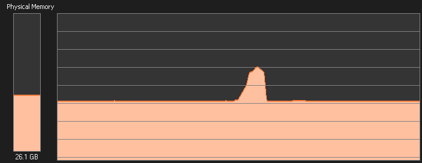
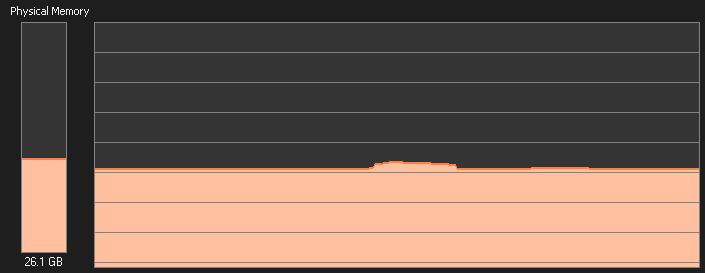

# sd-mecha

[](https://badge.fury.io/py/sd-mecha)
[](https://discord.gg/invite/2EPaw6fxxm)

sd-mecha is a memory efficient model merging and conversion library. Quick example:

```python
import sd_mecha

# create the merge plan
a = sd_mecha.model("path/to/model_a.safetensors")
b = sd_mecha.model("path/to/model_b.safetensors")
recipe = sd_mecha.weighted_sum(a, b, alpha=0.5)

# merge!
sd_mecha.merge(recipe, output="path/to/model_out.safetensors")
```

## Features

- Memory efficient model merging: merge a very large number of models in one execution
- Per-key merge control: set a different blend weight or use a different merge method for each parameter tensor
- Human-readable serialization format (.mecha)
- Extensible library interface:
  - user-defined models
  - user-defined merge methods and architecture conversions
- Built-in support for [popular diffusion models and their checkpoint key formats](docs/guide/0-introduction.md#built-in-checkpoint-key-formats)
- Merge LyCORIS networks together and apply them to checkpoints
- Extract LoRA, LoKr, Norm, and BOFT adapters
- [Merge Block Weighted (MBW)](docs/guide/1-typical-use-cases.md#blocks-merging-mbw)

## Install

```commandline
pip install sd-mecha
```

Make sure to install the appropriate release of [`torch`](https://pytorch.org/get-started/locally/) to get the best performance.

## Usage

See the [sd-mecha guide](docs/guide) for an in-depth exploration of the library.

## Examples

### Merge models

Here's an example script that merges two models:

```python
import sd_mecha

# create the merge plan
model_a = sd_mecha.model("path/to/model_a.safetensors")
model_b = sd_mecha.model("path/to/model_b.safetensors")
recipe = sd_mecha.weighted_sum(model_a, model_b, alpha=0.5)

# merge!
sd_mecha.merge(recipe, output="path/to/model_out.safetensors")
```

See the [examples](/examples) directory for more examples.

### Get Model-Specific Information

The library uses a "model config" to designate any specific set of keys of a certain shape.

It is possible to list all available model configs through the `sd_mecha.extensions.model_configs` module:

```python
from sd_mecha.extensions import model_configs

all_configs = model_configs.get_all()

print([config.identifier for config in all_configs])
# Includes "sd1-ldm", "sdxl-sgm", "sd3-comfyui", ...
```

A component of a model config is a subset of keys of the config that belong to the same logical group.
For example, all keys starting with "first_stage_model." in Stable Diffusion 1 models belong to the component "vae".

It is possible to query the different components of a model config:

```python
from sd_mecha.extensions import model_configs

config = model_configs.resolve("sd1-ldm")
for component_id, component in config.components().items():
      # component.keys() returns the state dict keys and their metadata
      print(f"{component_id}")

# this prints:
#   clip_l
#   vae
#   diffuser
#   ema
#   scheduler
```

## Motivation

Keeping track of full merge recipes has always been a problem for me.
I needed something that allows to store merge recipes in a readable format while also being executable.
I also needed something that allows to fully merge an entire tree of models without having to save intermediate models to disk.

Typically, mergers load all models in memory before initiating the merge process.
This can be very inefficient when the merge focuses on each key individually:



sd-mecha doesn't have this problem as it saves keys as soon as it can:



This allows to merge a very large number of models simultaneously on low-end hardware.

## Special mentions

Thanks to @blue-pen5805 for their work that helped bring Anima support to sd-mecha. [Original comfy-mecha extension](https://github.com/blue-pen5805/comfy-mecha-extensions-anima)
